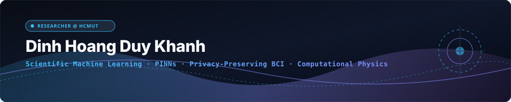
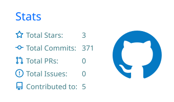
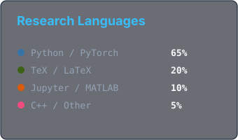

<p align="center">
  
</p>

<div align="center">

<a href="https://khanhhoangduydinh.github.io/">
  
</a>

<p>
  <a href="https://khanhhoangduydinh.github.io/"></a>
  <a href="https://scholar.google.com/citations?user=mZ0qwZYAAAAJ&hl=vi&oi=ao"></a>
  <a href="https://orcid.org/0009-0006-5707-9161"></a>
  <a href="https://www.linkedin.com/in/dinhhoangduykhanh2003/"></a>
  <a href="https://www.researchgate.net/profile/Duy-Khanh-Dinh-Hoang"></a>
  <a href="mailto:khanh.dinhhoangduy@hcmut.edu.vn"></a>
  
</p>

</div>

---

### 👋 Hi, I'm Duy Khanh (Đinh Hoàng Duy Khánh)

I am a graduate researcher at **[Ho Chi Minh City University of Technology (HCMUT - VNU-HCM)](https://hcmut.edu.vn/en)**, pursuing an intensive Master's in Computer Science & Engineering Physics. I completed my B.Sc. in Engineering Physics at HCMUT (2021–2025) and currently conduct research under the advisement of **[Assoc. Prof. Tran Van Hoai](https://scholar.google.com.vn/citations?user=V-UZo0kAAAAJ&hl=en)**, **[Assoc. Prof. Nguyen Thanh Nha](https://fas.hcmut.edu.vn/personnel/nhanguyen)**, and **[Assoc. Prof. Tran Trung Nghia](https://fas.hcmut.edu.vn/personnel/ttnghia)**.

My research sits at the convergence of **Scientific Machine Learning (SciML)**, **Computational Physics**, and **Neuroengineering**:
1. **Structure-Preserving SciML & PINNs:** Designing physics-informed deep learning architectures that strictly enforce conservation laws, symmetries, and Hamiltonian/Lagrangian mechanics when solving complex non-linear Partial Differential Equations (PDEs).
2. **Privacy-Preserving Brain-Computer Interfaces (BCI):** Integrating Homomorphic Encryption (Paillier HE) into clinical EEG & EMG signal processing pipelines to enable zero-knowledge neural decoding and P300 classification without compromising patient privacy.
3. **Computational Biomechanics:** Developing meshfree numerical methods for simulating soft tissues dynamics and bone remodeling algorithms.

> [!IMPORTANT]
> **🎓 Prospective PhD Applicant (Fall 2026 / Spring 2027)**  
> I am actively seeking PhD opportunities in **Computer Science**, **Scientific Machine Learning**, or **Computational Science & Engineering** in top research groups globally. If my research aligns with your lab, feel free to reach out via [Email](mailto:khanh.dinhhoangduy@hcmut.edu.vn) or [LinkedIn](https://www.linkedin.com/in/dinhhoangduykhanh2003/).

```yaml
khanh:
  role:       Graduate Researcher @ HCMUT · VNU-HCM
  advisors:   [Tran Van Hoai, Nguyen Thanh Nha, Tran Trung Nghia]
  core_areas: [Scientific ML (PINNs), Homomorphic Encryption in BCI, Numerical PDEs]
  languages:  [Python (Primary), MATLAB (Primary), C/C++, LaTeX, Bash]
  education:
    - M.Eng. Computer Science · HCMUT (2025 – Present)
    - B.Sc. Engineering Physics (High-Distinction Honor) · HCMUT (2021 – 2025)
  interests:  [SciML, Neural Decoding, Meshfree Methods, Computational Physics]
  born:       2003
```

---

### 📰 Highlights & News

- `2026-10` Submitted manuscript on **"Structure Preserving Machine Learning Enhanced Numerical Methods for Partial Differential Equations"** to *Computer Methods in Applied Mechanics and Engineering (Elsevier)*.
- `2025-11` Presented **"Secure BCI with Homomorphic Encryption"** at **EUREKA 2025**, proving zero accuracy loss in EEG P300 classification over ciphertext.
- `2025-06` Graduated with Bachelor's in Engineering Physics at HCMUT; transitioned directly into research-intensive Master's program.

<sub>All published preprints and papers are indexed on <a href="https://scholar.google.com/citations?user=mZ0qwZYAAAAJ&hl=vi&oi=ao">Google Scholar</a>. Personal portfolio available at <a href="https://khanhhoangduydinh.github.io/">khanhhoangduydinh.github.io</a>.</sub>

---

### 🔬 Research Projects & Selected Codebases

#### 1. Scientific Machine Learning & Computational Mathematics

**[Structure-Preserving SciML for PDEs](https://github.com/khanhhoangduydinh)** <br/>
Coupling structure-preserving neural operators and symplectic integrators with traditional mesh-based/meshfree numerical solvers to eliminate numerical dissipation in stiff partial differential equations.<br/>
<sub>`Python` · `PyTorch` · `PINNs` · `Numerical Analysis` · `PDEs` · `Scientific Computing`</sub>

**[CO5085 - Deep Learning & Computer Vision](https://github.com/khanhhoangduydinh/CO5085-Deep_Learning_and_Its_Applications_in_Computer_Vision)** <br/>
Extensive benchmark implementation of deep architectures (CNNs, ResNets, Attention modules) on vision datasets with rigorous mathematical convergence evaluation and LaTeX technical reports.<br/>
<sub>`Python` · `PyTorch` · `Computer Vision` · `LaTeX`</sub>

#### 2. Neuroengineering & Privacy-Preserving AI

**[Secure-BCI-Homomorphic-Encryption](https://github.com/khanhhoangduydinh/-EUREKA2025-Secure-BCI-with-Homomorphic-Encryption-A-Case-Study-on-EEG-Based-P300-Classification)** <br/>
Privacy-preserving EEG brain-computer interface system using Paillier Homomorphic Encryption. Evaluated on the `bigP3BCI` dataset with time-windowing and xDAWN spatial filtering + encrypted LDA, achieving identical classification AUC as unencrypted baselines.<br/>
<sub>`Python` · `Homomorphic Encryption` · `BCI` · `EEG Signal Processing` · `xDAWN` · `Paillier`</sub>

**[CO5177 - Data Analytics & Visualization Foundation](https://github.com/khanhhoangduydinh/CO5177-Programming_Foundation_for_Data_Analytics_and_Visualization)** <br/>
Algorithmic pipelines, statistical inference modeling, and high-dimensional biosignal visual analytics.<br/>
<sub>`Jupyter Notebook` · `NumPy` · `Pandas` · `Scikit-Learn` · `Seaborn`</sub>

<sub>[Explore all repositories and code experiments →](https://github.com/khanhhoangduydinh?tab=repositories)</sub>

---

### 🛠️ Scientific & Technical Toolbox

<div align="center">

<p><b>Core Languages (Primary: Python & MATLAB)</b></p>
<p>
  
</p>

<p><b>Scientific Machine Learning, PINNs & Numerical Computing</b></p>
<p>
  
</p>

<p><b>Data Engineering, Tools & Environment</b></p>
<p>
  
</p>

</div>

---

### 📈 GitHub Analytics & Contribution Graph

<div align="center">
  
  
  <br/>
  
</div>

<br/>

<div align="center">
  <picture>
    <source media="(prefers-color-scheme: dark)" srcset="https://raw.githubusercontent.com/khanhhoangduydinh/khanhhoangduydinh/output/snake-dark.svg" />
    <source media="(prefers-color-scheme: light)" srcset="https://raw.githubusercontent.com/khanhhoangduydinh/khanhhoangduydinh/output/snake.svg" />
    
  </picture>
</div>

---

<details>
<summary><b>📚 Academic Publications & Preprints</b></summary>
<br/>

1. **Structure Preserving Machine Learning Enhanced Numerical Methods for Partial Differential Equations**  
   *Duy Khanh Dinh Hoang*, Quoc Thai Hoang, Van Hoai Tran, Thanh Nha Nguyen  
   *Journal of Computer Methods in Applied Mechanics and Engineering (Elsevier)* — Under Review (2026).

2. **Secure BCI with Homomorphic Encryption: A Case Study on EEG-Based P300 Classification**  
   *Duy Khanh Dinh Hoang*, Nguyen Thanh Nha, Tran Trung Nghia  
   *EUREKA Scientific Research Conference* (2025).

</details>

<details>
<summary><b>☕ Beyond the Equation (Personal Interests)</b></summary>
<br/>

- 🌌 **Astrophysics & Cosmology:** Fascinated by general relativity, cosmic microwave background radiation, and celestial mechanics.
- 📖 **Hard Sci-Fi & Speculative Fiction:** Reading deep literature that explores future physics and the nature of consciousness.
- 🎶 **Music:** US-UK, melodic K-pop & V-pop during analytical work; ambient beats during coding sprints.
- ♟️ **Analytical Puzzles & Algorithms:** Continuously challenging mathematical reasoning and problem-solving intuition.

</details>

<br/>

<div align="center">

**Open to collaboration on Scientific Machine Learning, Computational Physics & Privacy-preserving BCI.**<br/>
<sub><code>khanh.dinhhoangduy [at] hcmut [dot] edu [dot] vn</code> · <a href="https://khanhhoangduydinh.github.io/">Homepage</a> · <a href="https://www.linkedin.com/in/dinhhoangduykhanh2003/">LinkedIn</a></sub>

</div>

<p align="center">
  
</p>
